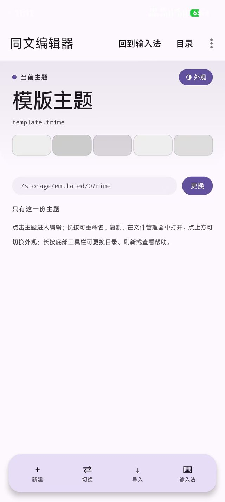
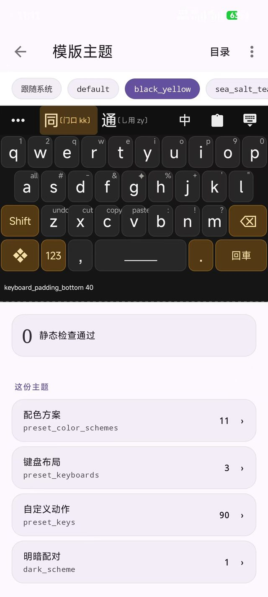
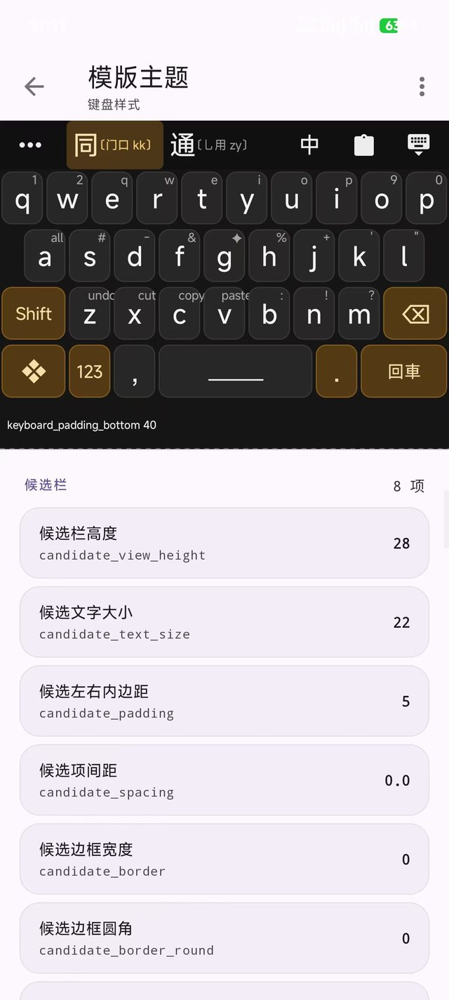
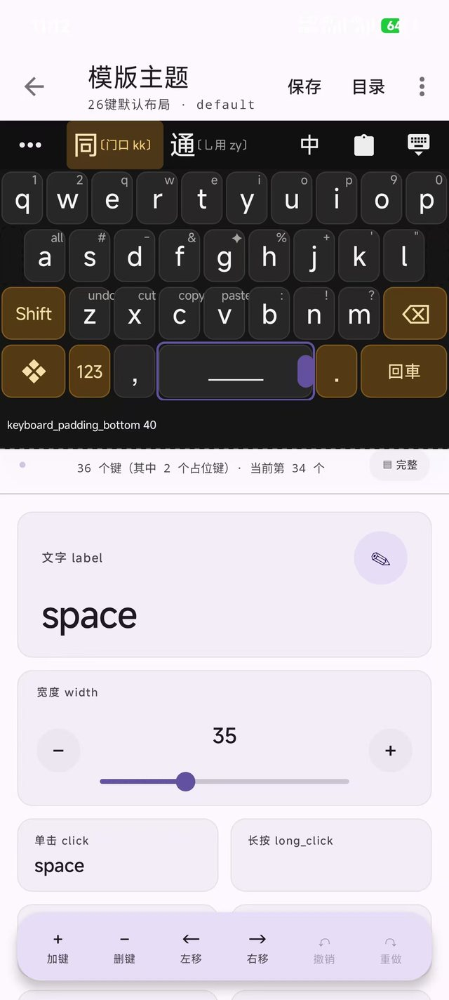
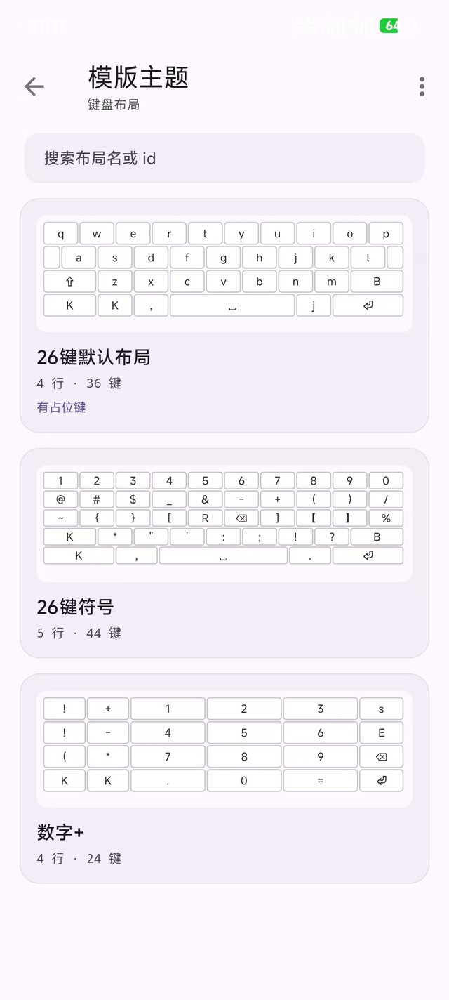
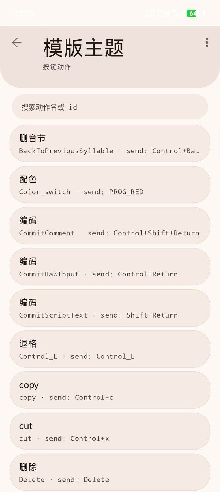

# 同文编辑器

同文输入法（Rime）主题的可视化编辑器 —— 在手机上改配色、键盘布局、按键动作，改完直接写回 `.trime.yaml`。

同文输入法的主题就是一份 `.trime.yaml`，配色、布局、动作全在里面。平时改它要对着文本一行行数缩进；这个 App 把它拆成六块可视化界面，你在屏幕上点的每一项，都会写回文件里对应的那一行。

**[下载 APK](https://github.com/lanlanderui/trime-theme-studio/releases/latest)** · Android 8.0+ · 不需要 root

| 6 类 | 90 个 | 1 行 |
|---|---|---|
| 可视化编辑对象 | 可自定义按键动作 | 改一项只产生一行 diff |

---

## 01 打开就看见所有主题

<table>
<tr>
<td width="250"></td>
<td>

一份主题就是一个 `.trime.yaml`。主题目录里有什么，这里就列什么，每张卡片带五块色卡 —— 那是这份主题下几套配色方案的缩略，不用点进去就能看出它偏深还是偏浅、偏冷还是偏暖。

- **色卡预览**：每份主题并排显示它的配色方案，深浅一眼分得出
- **底部四件事**：新建、切换、导入、回到输入法
- **长按**可重命名、复制，或直接在文件管理器里打开原文件
- 路径栏显示主题实际存放位置，`/storage/emulated/0/rime` 可随时更换

</td>
</tr>
</table>

## 02 改一个字段，键盘立刻变

<table>
<tr>
<td width="250"></td>
<td>

进入一份主题，顶部直接渲染真实键盘 —— 用的是你当前这份主题的配色、字号、间距，不是示意图。点一下配色方案的名字就换一套，所见即所得。

- **配色方案切换**：跟随系统 / default / black_yellow / sea_salt_teal… 横向切换
- **静态检查通过**：这份 YAML 能不能被输入法读出来，进编辑之前就告诉你
- 下面按「这份主题」列出四类内容：**配色方案 11**、**键盘布局 3**、**自定义动作 90**、**明暗配对 1**
- 每类后面带数字，点进去就是对应的编辑页

</td>
</tr>
</table>

## 03 候选栏、字号、边框，逐项调

<table>
<tr>
<td width="250"></td>
<td>

每一行左边是中文说明，下面一行小字是它在 YAML 里的真实字段名，右边是当前值。改的时候你始终知道自己在动文件的哪一行，不用去猜 `candidate_border_round` 到底控制什么。

- **候选栏高度** `candidate_view_height` 28
- **候选文字大小** `candidate_text_size` 22
- **候选左右内边距** `candidate_padding` 5 · **候选项间距** `candidate_spacing` 0.0
- **候选边框**的宽度与圆角，拖到 0 就是无边框
- 按组分页（当前「候选栏」共 8 项），改完上方键盘预览同步刷新

</td>
</tr>
</table>

## 04 在画布上拖，把键排好

<table>
<tr>
<td width="250"></td>
<td>

键盘布局不是表格，是画布。点中任意一个键（图里是空格键），下方立刻变成它的属性面板：文字、宽度、单击动作、长按动作。宽度用滑杆配加减键，按 5 一档调，不用敲数字。

- 标题栏实时统计：**36 个键（其中 2 个占位键）· 当前第 34 个**
- `label` 改键面文字，`width` 改宽度（空格当前 35）
- `click` / `long_click` 指定单击和长按要发送什么
- 底部六个动作：加键、删键、左移、右移、**撤销、重做**
- 改动先进草稿，点「保存」才写回文件 —— 中途退出不会写坏主题

</td>
</tr>
</table>

## 05 每套布局都有一张真缩略图

<table>
<tr>
<td width="250"></td>
<td>

一份主题里通常有字母、符号、数字好几套布局，来回切。这里每套都按自己的实际键位画缩略图，再标上行数和键数 —— 26 键符号那套 5 行 44 键，一眼就能看出比字母布局多一行。

- **真实缩略图**：按键比例、行数、特殊键位都对得上
- 「4 行 · 36 键」这样的规模标注，旁边提示**有占位键**
- 顶部可直接搜索布局名或 id
- 新增、删除、重命名布局都在这一页

</td>
</tr>
</table>

## 06 90 个动作，说清每个键干什么

<table>
<tr>
<td width="250"></td>
<td>

输入法里能自定义的不只是字母键。这里把主题定义的全部按键动作列出来，每一行都写明白它叫什么、内部 id 是什么、最终向输入法发送什么指令。

- **删音节** · `BackToPreviousSyllable` · send: Control+BackSpace
- **编码** · `CommitComment` · send: Control+Shift+Return
- **配色** · `Color_switch` · send: PROG_RED —— 一个键切整套配色
- 支持搜索动作名或 id，改动作的发送内容、增删动作
- 定义好的动作可以在布局页直接挂到任意键的 `click` / `long_click` 上

</td>
</tr>
</table>

---

## 写在文件上，不是写在数据库里

这个编辑器没有自己的存储。所有改动都直接落到那份 `.trime.yaml`，输入法读到就是新的 —— 这也是它敢让你随便试的原因：最坏情况只是文件里多了一行你看得懂的配置。

**只改你动的那一行**
YAML 按文本级修改，不重新序列化。注释、缩进、空行、行尾是 LF 还是 CRLF，全部原样保留，改一项就只产生一行 diff。

**别人改过会告诉你**
在文件管理器或电脑上动过同一份主题，回来时顶部会出现提示，而不是闷头覆盖掉对方的改动。

**改坏了能回头**
布局编辑带完整的撤销 / 重做栈；主题改到一半退出，草稿不写盘。真要重来，把那一行注释掉就能恢复默认。

---

## 安装

从 [Releases](https://github.com/lanlanderui/trime-theme-studio/releases/latest) 下载最新的 `trime-editor-v*.apk` 直接安装。

首次打开如果主题目录还没指定，点路径栏右边的「更换」选到同文输入法的 `rime` 目录即可。

## 从源码构建

```bash
cd android
./gradlew assembleDebug
```

需要 JDK 17+ 与 Android SDK（compileSdk 37），产物在 `android/app/build/outputs/apk/debug/`。

完整的工程说明、发布签名、版本配对、快捷入口配置、测试方式见 **[android/README.md](android/README.md)**。

## 目录结构

```
android/
├── app/            应用壳：导航、设置、崩溃日志
├── editor-ui/      编辑器界面：六个编辑页、预览板、工具条
├── theme-editor/   编辑逻辑：草稿、撤销栈、写回调
├── theme-runtime/  与同文输入法通信：复核、刷新、跳转
└── theme-core/     主题模型与 YAML 读写（纯 JVM，可单测）
```

`theme-core` 不依赖 Android，YAML 的解析与逐字节写回都在这里，配套 300+ 个单元测试；`editor-ui` 的预览板与输入法共用同一套绘制代码，所以编辑器里看到的就是键盘真实的样子。

## 其它

仓库根目录的 `app.js` / `styles.css` 是早期的网页版主题编辑器，仍然可用，和这个 Android App 相互独立。

## 许可证

GPL-3.0-or-later，见 [LICENSE](LICENSE)。
